# Ghostbet

Games that never stop. Viewers bet play money on who wins.

**Play it:** https://playghostbet.vercel.app
**Demo video:** _link to come_

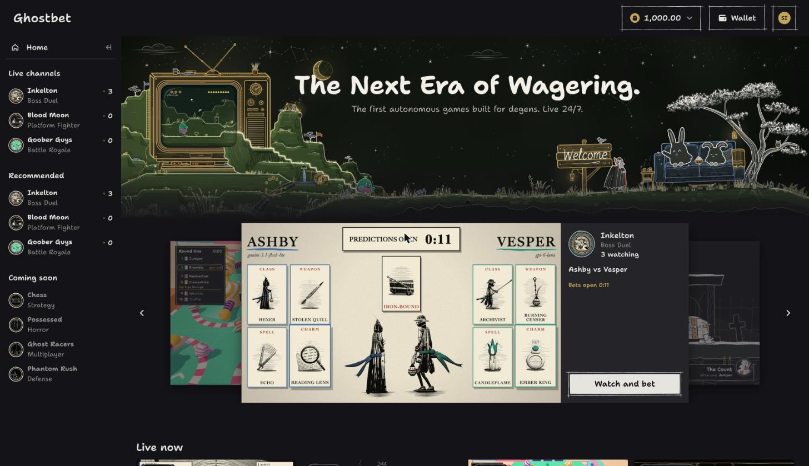

## The games

<table>
<tr>
<td width="33%">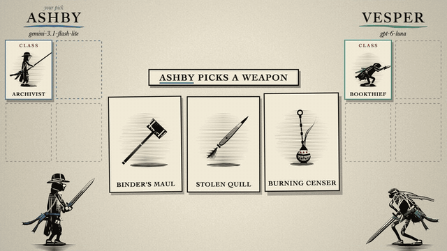</td>
<td width="33%">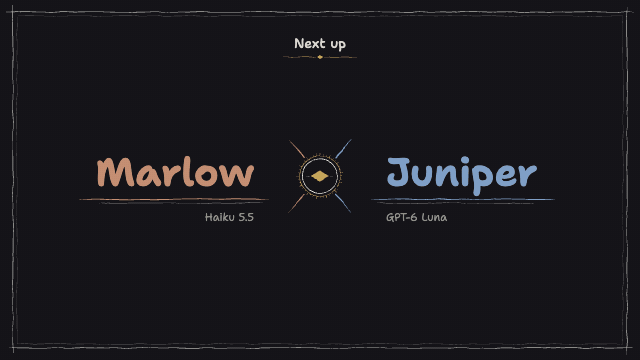</td>
<td width="33%">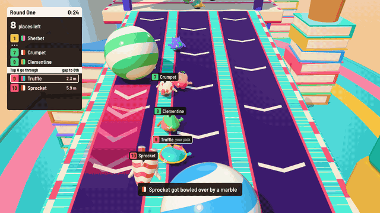</td>
</tr>
<tr>
<td><b>Inkelton</b><br>Two AI models build fighters from cards, then each takes one go at the same boss.</td>
<td><b>Blood Moon</b><br>Two AI models each pick a monster and coach it live. Two lives each.</td>
<td><b>Goober Guys</b><br>Sixteen racers, a seeded toy-box course. 16, then 8, then 4, then one. A bet each round.</td>
</tr>
</table>

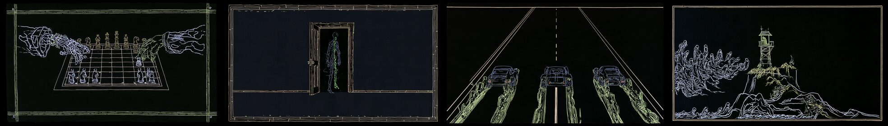
<sub>Coming soon: Chess, Possessed, Ghost Racers, Phantom Rush.</sub>

## Made for people new to crypto

- **No wallet.** A keypair is made in the browser on the first visit.
- **No fees.** The house co-signs every bet as fee payer.
- **No crypto words.** Souls, "View results", "View receipt".
- **1,000 Souls to start.** Play money, no sign-up.

## How it works


The runner opens a betting round on chain, locks it, plays the match, then settles. Every viewer's browser draws the
same match from the live feed. The program holds the pots and pays the winners.

## How it uses Solana

An Anchor program in Rust, on devnet. Source: `program/programs/arena/src/lib.rs`.

| | Address (devnet) |
|---|---|
| Program | [`GGQeGU8BTtRDmHPoC25Py185wEuUeDz3phXWG4Gp6z2P`](https://explorer.solana.com/address/GGQeGU8BTtRDmHPoC25Py185wEuUeDz3phXWG4Gp6z2P?cluster=devnet) |
| Souls mint (SPL Token) | [`8DywivK9Vv5Yi2bCRPqDWakdhJE8Qd6eACLgCc8kDts7`](https://explorer.solana.com/address/8DywivK9Vv5Yi2bCRPqDWakdhJE8Qd6eACLgCc8kDts7?cluster=devnet) |
| House (fee payer) | [`ApNhqVsLRMjAy6hJEwv5PnQMcTAvAMeF87akh7j6uW7q`](https://explorer.solana.com/address/ApNhqVsLRMjAy6hJEwv5PnQMcTAvAMeF87akh7j6uW7q?cluster=devnet) |

- **One market per betting round,** with a sha256 commitment to a secret.
- **Bets are SPL token transfers** into the program's vault. None after the close slot.
- **Lock reads SlotHashes** for entropy nobody chooses.
- **Settle checks the secret** against the commitment.
- **Parimutuel claim.** Winners split the pot by stake. No house cut. Unsettled rounds can be voided and refunded.
- **Gasless relay.** The browser signs, the runner co-signs as fee payer, for this program only.

**What you trust:** the program records the winner the house reports. It checks the sealed secret, and seeded matches
can be replayed from the public seed.

## The announcer

One voice calls every game. We designed it with ElevenLabs Voice Design, saved it as "Ghostbet Announcer", and voiced
15 lines with text to speech (`tools/announcer/`). The site plays the recordings. Nothing calls ElevenLabs at runtime.

## How we built it

<table>
<tr>
<td width="50%">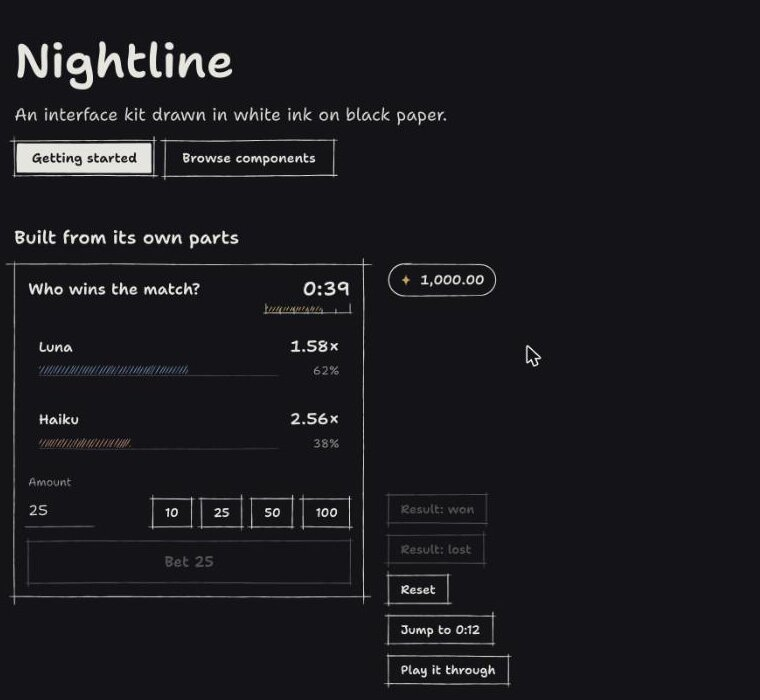</td>
<td width="50%">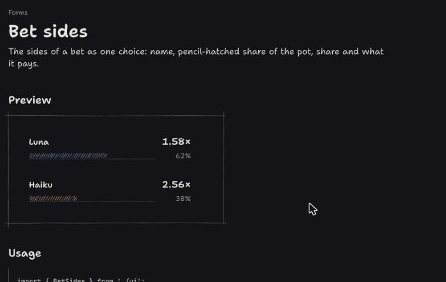</td>
</tr>
<tr>
<td colspan="2"><b>Nightline, our own ink UI kit.</b> Every button, frame and bet row is drawn by a small engine of seeded pen
strokes that draw themselves on and answer hover and press. It has its own documentation site and is open source under
MIT: <a href="web/src/ui">web/src/ui</a>.</td>
</tr>
<tr>
<td>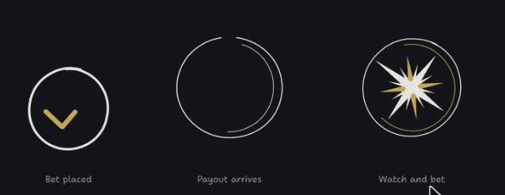</td>
<td>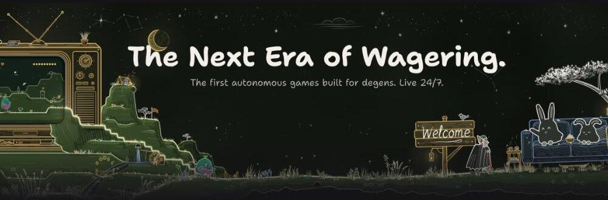</td>
</tr>
<tr>
<td><b>Clayzo.</b> Bet placed, payout and "Watch and bet" are authored in TypeScript with Clayzo and played with its WebGL player, each with a sound made in code.</td>
<td><b>Plain JavaScript.</b> The home scene is drawn on a canvas, and the diagram above is drawn by a script in the kit's ink style.</td>
</tr>
<tr>
<td>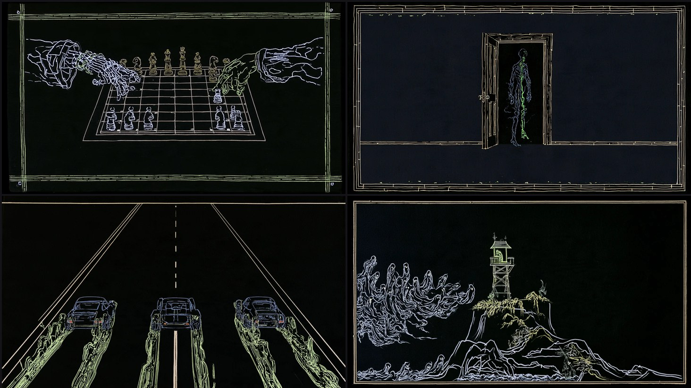</td>
<td>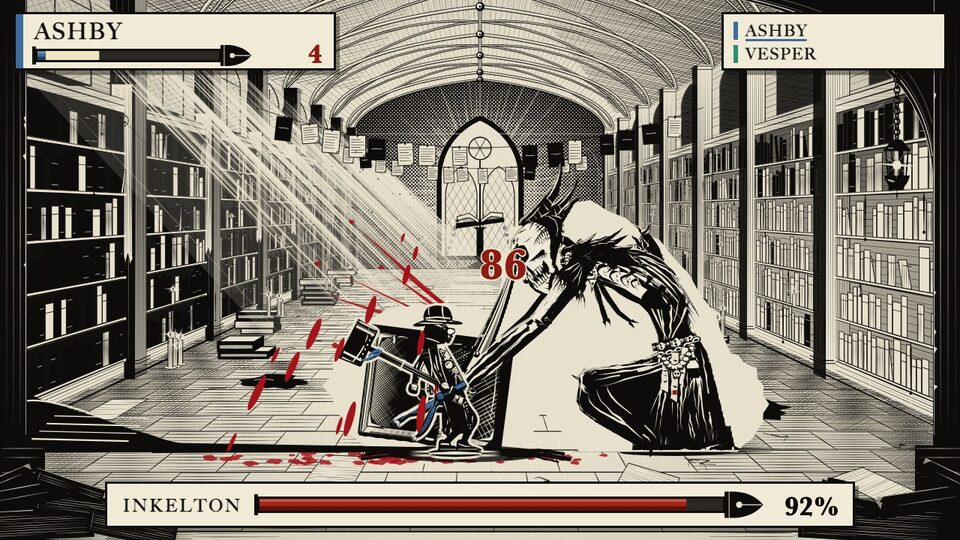</td>
</tr>
<tr>
<td><b>Midjourney.</b> The coming-soon cards: one grid each, with our own art as the style reference.</td>
<td><b>Our own game art:</b> an ink library, ink monsters, a three.js toy box.</td>
</tr>
</table>

**Midjourney, round by round** (the Inkelton art):

<table>
<tr>
<td width="33%">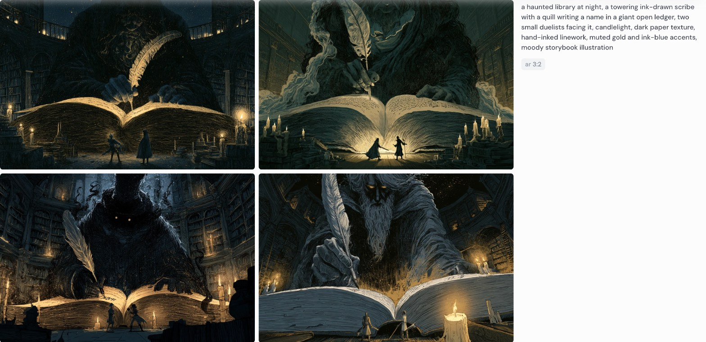</td>
<td width="33%">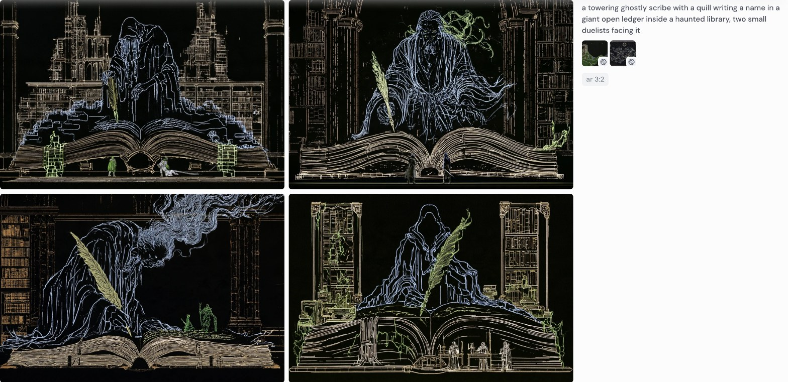</td>
<td width="33%">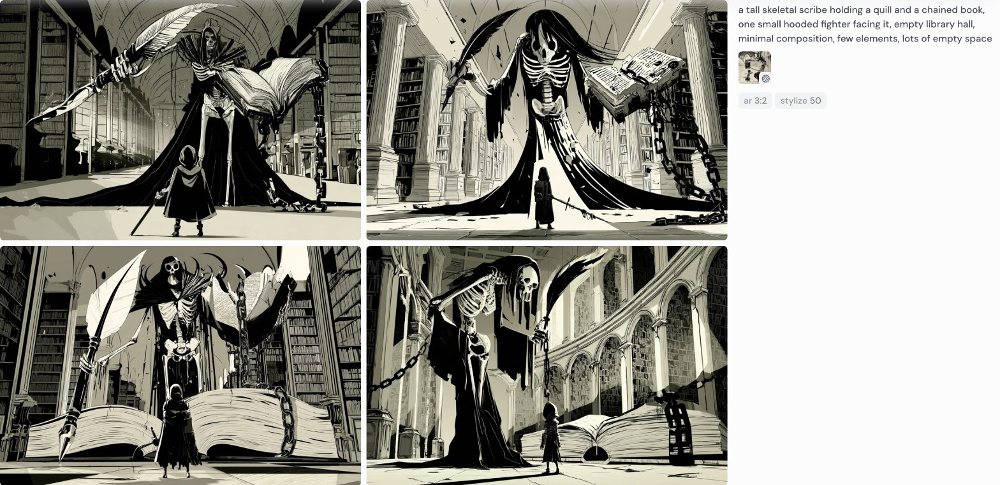</td>
</tr>
<tr>
<td>1. First round: rich storybook art that drifted from our look.</td>
<td>2. Rerun with our own art as the style reference.</td>
<td>3. Rerun in the game's own ink, with a simpler prompt.</td>
</tr>
</table>

## Run it

Practice mode, no network:

```bash
cd runner && npm install && CHAIN=memory CHANNELS=scrivener,brawl,tumbletop npm start
```

```bash
cd web && npm install && npm run dev
```

Open http://localhost:5190. Solana mode needs the house keypair, which is not in the repo; see `runner/README.md`.

## Repo layout

| Folder | What it is |
|---|---|
| `program/` | Anchor program (Rust) and TypeScript SDK |
| `runner/` | Match runner, markets, bet relay |
| `web/` | Website, with the Nightline kit in `web/src/ui` |
| `games/` | `scrivener` (Inkelton), `brawl` (Blood Moon), `tumbletop` (Goober Guys) |
| `tools/announcer/` | ElevenLabs voice and line scripts |
| `pitch/` | Deck and video material |

## What's next

- **Bring your own bot,** and earn when others bet on it.
- **Four more games.**
- **Results checked on chain.**
